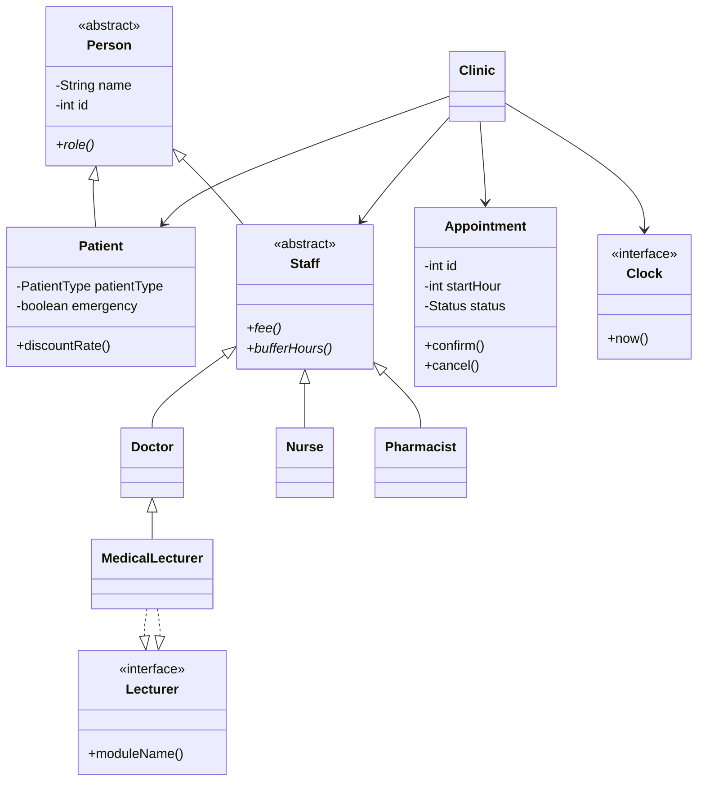

# Clinic Appointment System (Java)

## Requirements

- Java 17 or newer (the project uses switch expressions).
- No external libraries or build tools are required.

## Compile and run

Open a terminal in the project root:

```bash
javac -d out src/clinic/*.java
java -cp out clinic.Main
```

The program creates/appends `appointments.log` in the directory where it is run.

## Important: select your assigned twist

Open `src/clinic/Main.java` and change:

```java
private static final int STUDENT_NUMBER_P = 100;
```

student number is (P). The program selects the required demonstration using `P % 4`:

- 0: waiting list
- 1: emergency booking
- 2: staff appointment buffers
- 3: patient discounts

## Class diagram



## Answers to the assignment

### 1. Classes and OOP structure

`Person` is abstract and stores private, final `name` and `id`. `Patient` and abstract `Staff` extend it. `Doctor`, `Nurse` and `Pharmacist` extend `Staff`. `Appointment` models a one-hour booking; `Clinic` coordinates registration and booking. `Clock` is an interface so time is supplied rather than read from the computer.

### 2. Encapsulation, invariants and state transitions

All fields are private (or, for the `Staff` constructor, protected only as a constructor); getters expose values, not mutable internal collections. `Clinic` returns defensive copies wrapped as unmodifiable lists. Constructors reject blank names and IDs less than or equal to zero.

Legal transitions:

- `PENDING -> CONFIRMED`
- `PENDING -> CANCELLED`
- `CONFIRMED -> CANCELLED`, only if at least two hours remain
- `CANCELLED` has no outgoing transition.

No cancellation is allowed when `clock.now() >= startHour`. Appointment status mutation methods are package-private; normal callers must use `Clinic`.

The invariants for `Appointment` and `Clinic` are written as comments immediately above those classes in source.

### 3. Polymorphic fees

`Clinic` loops over `List<Staff>` and calls `role()` and `fee()`. Each subclass supplies its own implementation. No `instanceof`, type tags or type checks are used in the fee loop. Adding a new staff subclass requires no change to the loop.

Fees:

- Doctor: `40 + 5 * (P mod 5)`, where P is the doctor's ID.
- Nurse: `10 + (P mod 3)`, where P is the nurse's ID.
- Pharmacist: `5`.

### 4. Logging and resource safety

`AppointmentLog` implements `AutoCloseable`. `Main` opens it in a Java try-with-resources statement. Java closes it when the block exits, including exceptional exits. Each Clinic action logs success or failure. For example, a failed cancellation is logged as `FAILED cancel #...: Too late...`. A log write/close failure is not silently hidden; it is surfaced as an application error.

### 5. MedicalLecturer and Java's inheritance model

Java does not support multiple inheritance of classes. `Lecturer` is therefore an interface. `MedicalLecturer extends Doctor implements Lecturer`. The single superclass constructor chain reaches `Person` exactly once. Its doctor fee is inherited from `Doctor`, because it is still a doctor providing a medical appointment. The counter in `Person` and the before/after output demonstrate one constructor call.

### 6. Clinic-wide rules and twists

The clinic checks unique person IDs across patients and staff, unique appointment IDs, registration, same-hour patient/staff conflicts, and staff buffer hours. Cancelled appointments do not block a slot.

All four twist implementations are included:

- Waiting list: the list belongs to a staff member because the released appointment slot belongs to that staff member. On cancellation, the clinic offers it to the first waiting patient who has no conflict.
- Emergency: only a pending appointment may be bumped. A confirmed booking represents an accepted commitment and cannot be displaced.
- Buffer: `Clinic` asks `Staff.bufferHours()`; each staff subclass owns its scheduling requirement. This is polymorphism rather than a type check.
- Discounts: patient subclasses/types provide the discount behaviour through `Patient.amountPayable()` / `discountRate()`, so the clinic does not inspect patient types.

### 7. Design decision log

- **D1 — Two-hour cancellation rule:** kept in `Appointment.cancel()` because it is a rule governing an appointment's own state transition. Putting it in Clinic would allow another caller to bypass it. A separate policy object would be more configurable, but adds complexity for this small fixed rule.
- **D2 — Testable clock:** `Clinic` receives a `Clock`. Tests can use `ManualClock` and move time deterministically. Direct system-time calls would make boundary tests dependent on the real time and harder to reproduce.
- **D3 — Adding Pharmacist:** only the new subclass and its fee/buffer implementations were needed; the polymorphic fee loop and Clinic do not check concrete staff types.
- **D4 — MedicalLecturer fee and one Person:** returns the Doctor fee by inheritance. Java's single class inheritance means the constructor chain creates one Person. Without that structure, manually composing/duplicating Person state could create inconsistent identities.
- **D5 — Log write/close failure:** write errors are surfaced as an unchecked application error; close errors are propagated by try-with-resources. The application must not claim an action was safely logged if the log itself failed.
- **D6 — Twist:** waiting list belongs to the staff member/slot; confirmed appointments cannot be bumped because they are accepted commitments; `bufferHours()` preserves polymorphism; discount calculation is a patient pricing responsibility.

## Notes

- Time is represented as integer hours from 0 to 168. Appointment start hours are 0 to 167 so a one-hour appointment fits inside the week.
- The demonstration uses a manual clock set by the program; it never reads the computer clock.
- This is an educational in-memory implementation. Data is not persisted to a database; the required action log is persisted to a text file.
